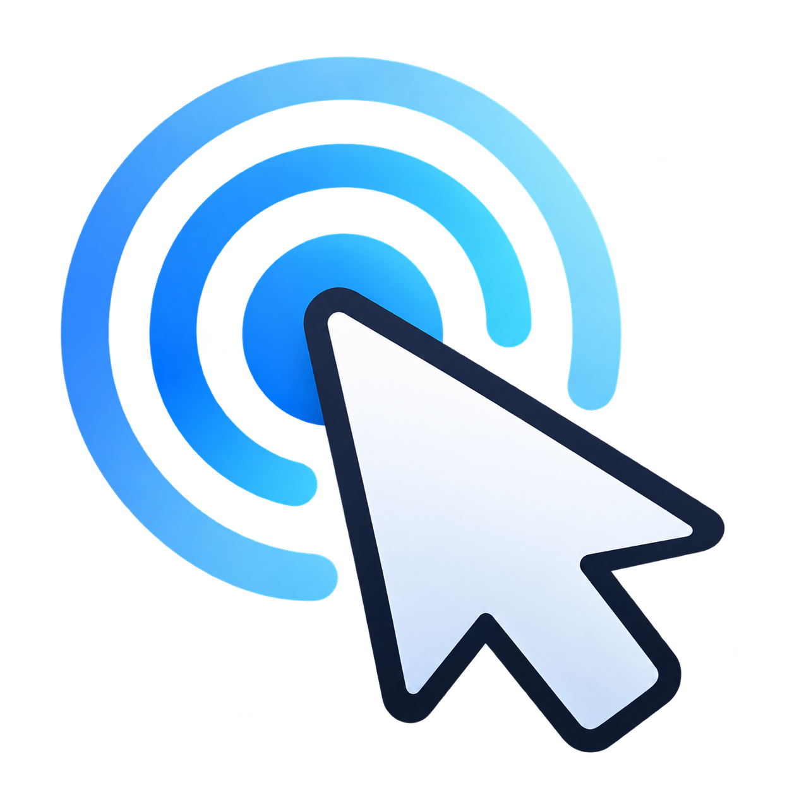

<p align="center"></p>

# TouchMouse

A small Windows utility for games that miss touchscreen taps or require two taps for one click. TouchMouse keeps touch-generated mouse clicks pressed long enough for polling-based input to detect them.

**[中文说明](#中文说明)** · **Preview 0.3.0** · Native ARM64 / x64 · MIT license

## Download and run

| Your Windows device | Download |
| --- | --- |
| Windows on ARM | [ARM64 portable ZIP](https://github.com/Mark8924/touch-mouse-bridge/releases/download/v0.3.0-preview/TouchMouse-0.3.0-preview-arm64.zip) |
| Intel / AMD Windows PC | [x64 portable ZIP](https://github.com/Mark8924/touch-mouse-bridge/releases/download/v0.3.0-preview/TouchMouse-0.3.0-preview-x64.zip) |

[Release notes, standalone EXEs and SHA-256 checksums](https://github.com/Mark8924/touch-mouse-bridge/releases/tag/v0.3.0-preview)

Extract the ZIP to a permanent folder and open `TouchMouse.exe`. No installer, .NET runtime, service or driver is required. The current settings UI is in Chinese; the instructions below identify the relevant controls. Binaries are unsigned.

1. Enable **触摸 → 鼠标转换** (touch compatibility).
2. Select **仅指定游戏** (selected games), add the actual game EXE and tick it. Alternatively choose **全局** (global).
3. Start with **标准鼠标单击** (standard single click) and the default **60 ms** hold. Adjust within **20–250 ms** if necessary.
4. If needed, try **左键双击兼容** (left double-click compatibility). It adds a second left click for a short tap. A drag does not receive the extra click; right clicks always remain single.
5. Windows' touch-and-hold right click is also extended, helping games detect it. This feature relies on Windows producing the right-click event; TouchMouse does not implement its own raw-touch long-press recognizer.

**Minimize hides to the notification area; × exits.** Click the tray icon to reopen settings. Right-click or touch-and-hold the tray icon for settings, enable/disable, optional startup, and exit. If Windows hides the icon, look under the notification area's `^` menu. Reopening the EXE shows the running instance instead of creating another helper.

Startup is optional and off by default. Enable it with **登录 Windows 后自动在后台运行**. It uses the current user's Run entry and starts with the settings window hidden; keep the EXE in its permanent folder.

| Shortcut | Action |
| --- | --- |
| Ctrl+Alt+F8 | Toggle compatibility |
| Ctrl+Alt+F9 | Show settings |
| Ctrl+Alt+F12 | Disable compatibility immediately |

## How it works and limitations

- A low-level mouse hook identifies mouse events promoted from touch using Windows' touch signature. It preserves the initial native mouse-down and movement, then delays mouse-up until the configured minimum duration. A short pulse becomes visible to games that periodically poll button state.
- Only touch-promoted primary mouse input is handled. This is not a replacement for native multi-touch, touch gestures, or every game's input API. Compatibility depends on the game; prefer per-EXE scope.
- Physical mouse and pen events pass through. On focus loss, lock, disable or exit, the helper releases button state it owns. Physical mouse input can take ownership without the helper interrupting its drag.
- Normal Windows input permission restrictions apply. An unelevated helper cannot send input to an elevated game. Prefer running both normally; **管理员运行** restarts the helper elevated when required.
- Developed and tested on Windows 11 ARM64. The x64 binary is compiled but has not yet been tested on an x64 device. Other Windows versions and games are not guaranteed.

Settings are saved automatically in `%LOCALAPPDATA%\TouchMouseBridge\settings.ini`. A fresh installation starts disabled with an empty game list. The tool does not network, upload data, modify game files, inject code into games, or store touch coordinates / key contents in normal operation. Optional self-tests write diagnostic reports only when explicitly invoked.

To remove it, disable startup in the UI, exit, and delete the extracted folder. Delete the settings folder too if you want a fresh configuration.

## Build and test

Use Python 3.9+ and [llvm-mingw](https://github.com/mstorsjo/llvm-mingw). The scripts use only Python's standard library. Download the toolchain for your build host and pass its root or `bin` directory:

```sh
python3 build.py --toolchain /path/to/llvm-mingw
```

On Windows, `python build.py --toolchain C:\tools\llvm-mingw` works too. Alternatively set `LLVM_MINGW_BIN` or add the toolchain's `bin` to `PATH`. Use `--arch arm64` or `--arch x64` to build one architecture. Output is `dist/TouchMouse-arm64.exe` and `dist/TouchMouse-x64.exe`. The C++ runtime is statically linked; Windows system DLLs and the built-in Universal CRT remain required.

Portable input-engine tests, using a host C++17 compiler:

```sh
clang++ -std=c++17 -Wall -Wextra -Werror tests/engine_tests.cpp -o tests/engine_tests
./tests/engine_tests
```

Windows integration tests, from an interactive desktop with the normal helper exited:

```powershell
.\TouchMouse-arm64.exe --self-test "$env:TEMP\TouchMouse-input-test.json"
.\TouchMouse-arm64.exe --tray-self-test "$env:TEMP\TouchMouse-tray-test.json"
```

Use the x64 EXE on an x64 device. The input self-test opens its own window; click it if focus is not acquired, then leave it alone. Generated test events are restricted to that window. It checks click duration, left single/double clicks, right clicks remaining single, physical mouse passthrough and safe release. The tray test checks registration, hiding, restoring and exit. These tests do not replace real-device checks in a target game. Development validation: 22 engine cases, 10 Windows input checks, 6 tray lifecycle checks, and real touchscreen left-click / touch-and-hold checks on ARM64.

The icon is an AI-generated raster asset. Its PNG, multi-resolution ICO, and generation prompt are included in `assets/`.

## 中文说明

TouchMouse 是一个轻量的 Windows 触控兼容工具，用于**触屏点按被漏读，或者需要点两下才响应一次**的游戏。它适当延长触屏产生的鼠标按键时间，让轮询按键状态的游戏读得到。

### 下载与使用

- **[ARM64 便携版](https://github.com/Mark8924/touch-mouse-bridge/releases/download/v0.3.0-preview/TouchMouse-0.3.0-preview-arm64.zip)**：Windows ARM 设备使用。
- **[x64 便携版](https://github.com/Mark8924/touch-mouse-bridge/releases/download/v0.3.0-preview/TouchMouse-0.3.0-preview-x64.zip)**：Intel / AMD Windows 电脑使用。
- **[版本详情、单独 EXE 与校验值](https://github.com/Mark8924/touch-mouse-bridge/releases/tag/v0.3.0-preview)**。

解压到固定目录，双击 `TouchMouse.exe` 即可，无需安装器、.NET、服务或驱动。当前界面为中文，程序未签名。

1. 勾选“触摸 → 鼠标转换”。
2. 建议选“仅指定游戏”，添加实际运行的游戏 EXE 并勾选；也可以选择全局生效。
3. 优先使用“标准鼠标单击”，默认保持 60 毫秒，可调整至 20–250 毫秒。
4. 必要时改为“左键双击兼容”：短点按补第二次左键，拖动不补；右键始终只有一次。
5. 触屏长按产生的右键也会被延长，帮助游戏识别。长按识别由 Windows 提供，本工具不自行实现原始触摸长按手势。

**最小化隐藏到右下角托盘，点 × 直接退出。** 单击托盘图标或重新打开 EXE 显示设置；右键或触屏长按托盘图标可切换启用、设置自启和退出。找不到图标时看看右下角 `^` 的隐藏图标区域。资源管理器重启后会重新注册图标。

自启默认关闭，可勾选“登录 Windows 后自动在后台运行”。启用后保持 EXE 路径不变，自启时不弹设置窗口。快捷键：`Ctrl+Alt+F8` 开关转换，`Ctrl+Alt+F9` 显示设置，`Ctrl+Alt+F12` 立即关闭转换。

### 原理、范围和数据

程序保留触屏产生的第一次鼠标按下和移动，延迟松开，解决部分旧游戏漏读瞬时按键的问题。双击模式再补一次左键。它只处理被 Windows 提升为鼠标事件的主触点，不替代多点触控，也不保证兼容所有游戏；建议按 EXE 启用。

物理鼠标和触控笔保持原样。失去焦点、锁屏、关闭转换或退出时，会释放工具持有的按键状态。目标游戏若以管理员身份运行，需要同等权限；优先都用普通权限，必要时点“管理员运行”。

已在 Windows 11 ARM64 实机验证；x64 版已编译，尚未进行 x64 实机验证。其他 Windows 版本和游戏的适配情况仍需测试。

配置自动保存于 `%LOCALAPPDATA%\TouchMouseBridge\settings.ini`，公开版默认关闭转换、不包含任何游戏配置。不联网、不上传数据、不修改游戏文件、不向游戏注入代码；正常运行不记录触摸坐标或按键内容。仅手动运行自测时生成诊断报告。

卸载时先取消自启、退出工具，再删除解压目录；需要重置配置时也可删除上述设置目录。构建与自测命令见英文部分。源码使用 MIT 许可证；图标原图、ICO 和生成提示词在 `assets/`。

## Technical references / 技术参考

- [Windows touch / pen mouse signature](https://learn.microsoft.com/en-us/windows/win32/tablet/system-events-and-mouse-messages)
- [LowLevelMouseProc](https://learn.microsoft.com/en-us/windows/win32/winmsg/lowlevelmouseproc)
- [SendInput and integrity-level restrictions](https://learn.microsoft.com/en-us/windows/win32/api/winuser/nf-winuser-sendinput)
- [GetAsyncKeyState](https://learn.microsoft.com/en-us/windows/win32/api/winuser/nf-winuser-getasynckeystate)
- [Shell_NotifyIcon](https://learn.microsoft.com/en-us/windows/win32/api/shellapi/nf-shellapi-shell_notifyiconw)
